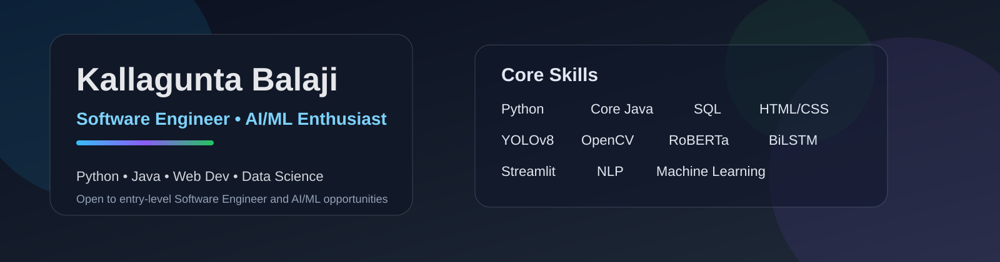

  
   
  
  <h1>Kallagunta Balaji</h1>
  
<strong>Software Engineer | Python · Core Java · Applied AI/ML</strong>

  
Advanced Computing student at C-DAC ACTS, Pune · Open to entry-level software engineering and data science opportunities

  

    
    
    
    
  

---

## About

Computer Science graduate pursuing a **Post Graduate Diploma in Advanced Computing at C-DAC ACTS, Pune**. I build practical projects in software development, natural language processing, computer vision, and data analytics. I’m focused on clear documentation, reproducible results, and communicating what a project demonstrates honestly.

- 🎓 **B.Tech in Computer Science** — St. Ann’s College of Engineering · CGPA **7.55/10**
- 📚 **PG Diploma in Advanced Computing** — C-DAC ACTS, Pune · Aug 2026–Feb 2027
- 🎯 Seeking entry-level **Software Engineering** and **Data Science** opportunities
- 📍 Andhra Pradesh, India · Open to relocation

## Technical Skills

| Area | Skills |
| --- | --- |
| Programming | Python · Core Java · SQL |
| Machine learning | PyTorch · Hugging Face Transformers · RoBERTa · BiLSTM · YOLOv8 |
| AI domains | Natural Language Processing · Deep Learning · Computer Vision |
| Applications & analytics | Streamlit · HTML · CSS · Bootstrap · Power Query · DAX |
| Tools & databases | Git · Google Colab · VS Code · MS Excel · SQL*Plus |

## Selected Projects

### [Context-Aware Sentiment Analysis — RoBERTa + BiLSTM](https://github.com/kallaguntabalaji12/Context-Aware-Sentiment-Analysis-Using-RoBERTa-and-BiLSTM)
NLP project describing a hybrid RoBERTa + BiLSTM approach, with single-text and batch sentiment prediction features. The repository README describes evaluation using accuracy, precision, recall, and F1-score, but does not publish numeric results; I’ll add scores after validating them against a documented test set.

**Python · PyTorch · Hugging Face Transformers · Streamlit**

### [Real-Time Sales Dashboard](https://github.com/kallaguntabalaji12/RealTimeSalesDashboard) · [Open live dashboard](https://kallaguntabalaji12.github.io/RealTimeSalesDashboard)
Power BI dashboard exploring sales KPIs, product trends, and country-wise performance. The repository reports **10.03M total sales**, **99K quantity**, **1.79M sales YTD**, and **Classic Cars at 39.07% of total sales**.

**Power BI · Excel · Power Query · DAX**

### [FreelanceFinder](https://github.com/kallaguntabalaji12/Freelancefinder)
Marketplace project for connecting clients and freelancers through job posts, bids, and project workflows. See the repository for implementation and setup details.

**JavaScript · React**

### Real-Time Object Detection and Tracking
Webcam-based detection and multi-object tracking project using YOLOv8 and OpenCV. This project is described in my resume; a public repository link is not currently available.

**Python · YOLOv8 · OpenCV**

## Certifications

- Full Stack Development (MERN) — SmartBridge Educational Services Pvt. Ltd.
- Short-Term Internship on Artificial Intelligence — APSCHE & AIMER Society
- Data Science Foundations — Great Learning Academy

## Current Focus

- Strengthening software engineering fundamentals, algorithms, and databases
- Developing well-documented Python and Java projects
- Publishing reproducible project demos, screenshots, and measured results

## Connect

- [LinkedIn](https://www.linkedin.com/in/balajikallagunta4425/)
- [Instagram](https://instagram.com/balaji_kallagunta_65)
- [Email](mailto:kallaguntabalaji143@gmail.com)
- [All repositories](https://github.com/kallaguntabalaji12?tab=repositories)

  Curious learner · Practical problem-solver · Open to opportunities

